<div align="center">


# CampusFind 1.1.0

**Good things find their way back.**

Campus Lost-and-Found Management System — a Python application for reporting belongings, searching campus listings, privately verifying ownership, and recording physical returns.

**Python 3.11+ · Flask · SQLAlchemy · SQLite · Responsive UI · No paid API**

[Quick start](#quick-start) · [Screenshots](#screenshots) · [Features](#features) · [Architecture](#architecture) · [Documentation](#documentation)

</div>

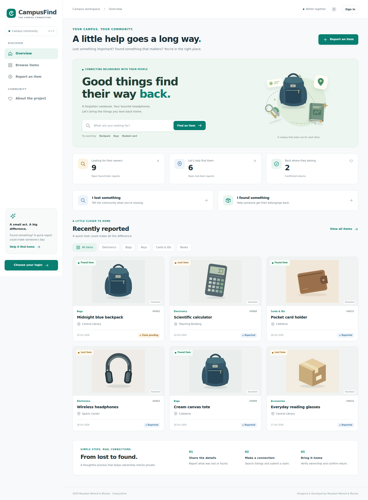

## Why this project exists

A lost wallet or notebook should not disappear into a busy group chat. CampusFind gives a campus one organized place to publish lost and found reports, look through searchable listings, and follow a careful return process.

It implements the four core features in the semester proposal: lost-item reporting, found-item reporting, item search/filtering, and claim/status management. Account management, notifications, and moderation support those core workflows.

## Quick start

Install **Python 3.11 or newer**, extract this project, open a terminal in the folder containing `run.py`, and run:

```bash
# Windows
python setup_project.py --demo
start.bat
```

```bash
# Linux / macOS
python3 setup_project.py --demo
chmod +x start.sh
./start.sh
```

Open **http://127.0.0.1:5000**. The setup command needs internet to install Python packages. After installation, the default application works locally without network services.

The optional demo creates fictional reports and prints student/finder demo login details. The supplied ZIP configures **admin@gmail.com** with your chosen administrator password during setup:

| Role | Email |
|---|---|
| Administrator | admin@gmail.com |
| Student | student@example.com |
| Finder | finder@example.com |

Choose **Login as Student** or **Login as Administrator** on the sign-in page. Administrators open the admin console directly; students open their dashboard. The password printed for demo students is separate from your configured administrator password.

To start without fictional reports, omit `--demo`. The ZIP includes a one-time hashed administrator setup under the Git-ignored `instance/` directory; setup consumes it after configuring the account. The plaintext password is not in the source or this README. A Git checkout without that private file uses `create-admin`, or a random demo administrator password printed by `seed-demo`. Demo seeding accepts an empty database or an otherwise-empty database containing only the configured administrator, and never overwrites that administrator password.

### Manual installation / PyCharm

```bash
python -m venv .venv
```

Activate the environment:

```powershell
# Windows PowerShell
.venv\Scripts\Activate.ps1
```

```bash
# Windows Command Prompt
.venv\Scripts\activate.bat
# Linux / macOS
source .venv/bin/activate
```

Then:

```bash
python -m pip install -r requirements-lock.txt
python -m flask --app campusfind:create_app init-db
# Supplied ZIP: apply its private one-time administrator setup
python -m flask --app campusfind:create_app configure-admin
# Git checkout without that file: use create-admin instead
python run.py
```

`create-admin` prompts for an email, display name, and password. Password entry is hidden. In PyCharm, open this folder, select `.venv` as the interpreter, and run `run.py` after the database setup.

The server uses Waitress on Windows and Linux. Stop it with **Ctrl+C**. To change the port, copy `.env.example` to `.env` and edit `PORT`.

## Updating an existing installation

Back up your `instance/` folder. Copy the updated source files and the supplied `instance/admin-bootstrap.json` into your existing project without replacing its database or uploads. Stop the old server and run:

```bash
python setup_project.py
```

Do **not** add `--demo` when keeping existing records. Setup applies migrations and creates/updates `admin@gmail.com` using the configured password, preserves reports and uploads, and consumes the one-time setup file. Restart, sign out of any old session, and select **Login as Administrator**. The web interface does not offer public administrator registration.

## Features

### Students

- Register and sign in; edit a profile and change a password.
- Publish lost/found reports with category, campus location, date, description, and an optional photograph.
- Search item names and descriptions; combine type, category, location, status, and date filters.
- Sort and paginate results.
- Edit an open report before active claim review; close an open report without active claims.
- Submit private ownership evidence for found items and track the administrator's decision.
- Answer requests for more information; withdraw a claim before approval.
- View in-app notifications and report histories.

### Administrators

- Review private evidence, request clarification, approve or reject claims with reasons.
- Confirm a physical handover separately from claim approval.
- Hide/close duplicate or invalid reports, restore visibility, and reopen eligible reports.
- View accounts and disable/re-enable student access.
- Review reporting charts and a recorded administrator activity log.

### Interface

Light/dark themes, responsive sidebar, accessible labels, image previews, real database statistics, meaningful empty states, confirmation dialogs, keyboard navigation, and reduced-motion support. SVG fallback illustrations are explicitly labeled as illustrations; uploaded photographs replace them.

## The return workflow

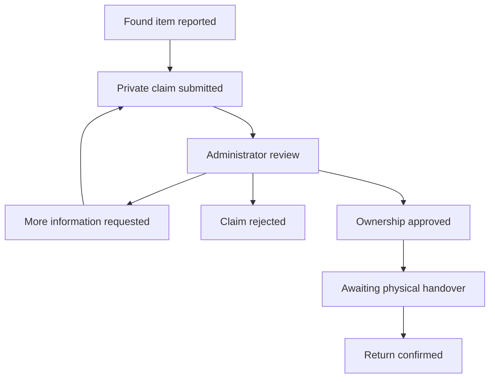

Approving a claim reserves the item. **Only a separate physical-handover confirmation marks it returned.** Approval rejects competing pending claims with an explanation. Students cannot claim their own reports, submit duplicate claims, review other students' private evidence, or grant themselves administrator access. An administrator cannot review a claim involving their own account.

A lost report directs people who found a matching item to publish a found report. Version 1.1.0 does not automatically link or merge the two reports. To record a confirmed recovery, use the verified claim on the found report; the lost report can be closed separately.

## Screenshots

These screenshots come from the running application with fictional demo data.

| Student login | Administrator login |
|---|---|
| 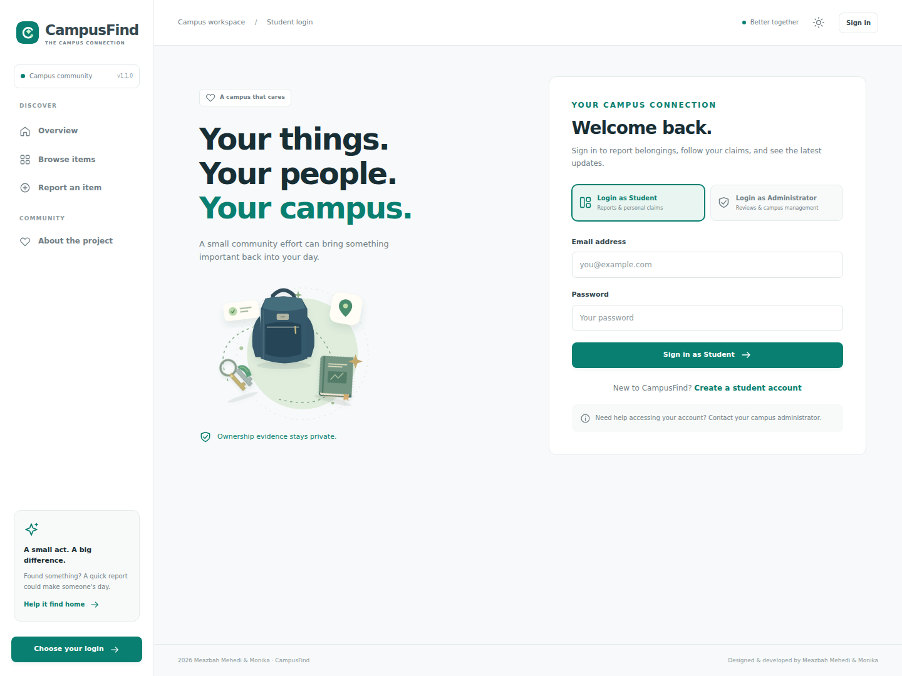 | 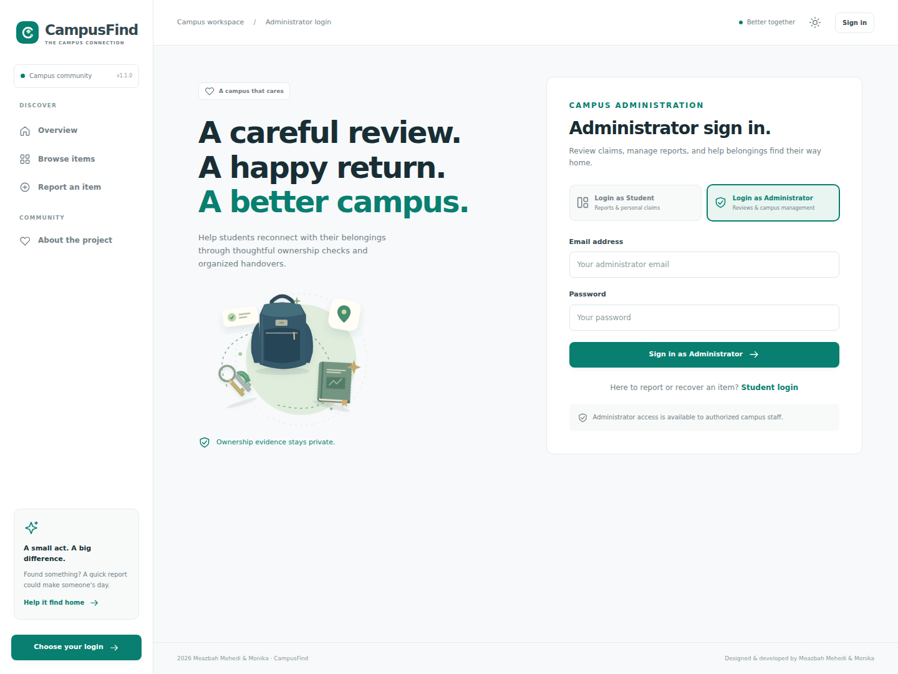 |

| Browse and filter | Student workspace |
|---|---|
| 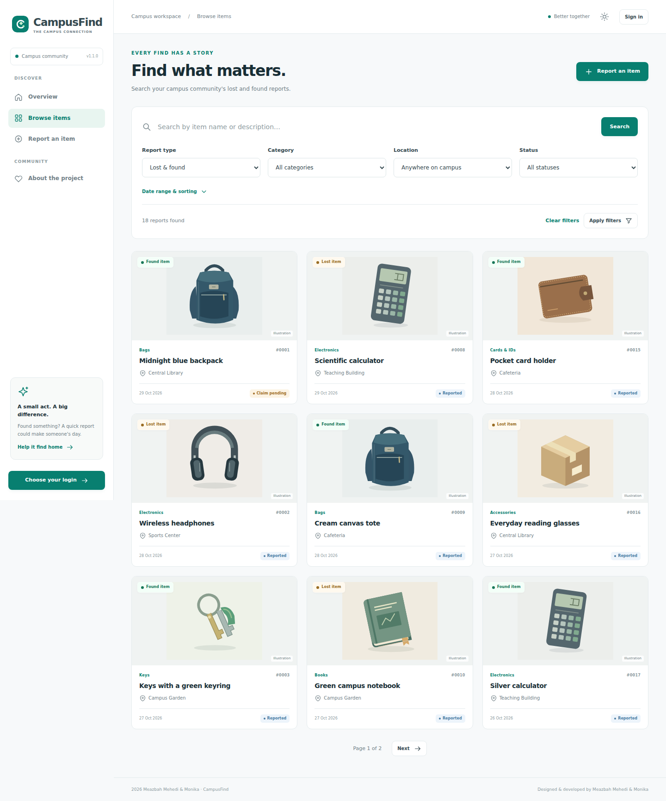 | 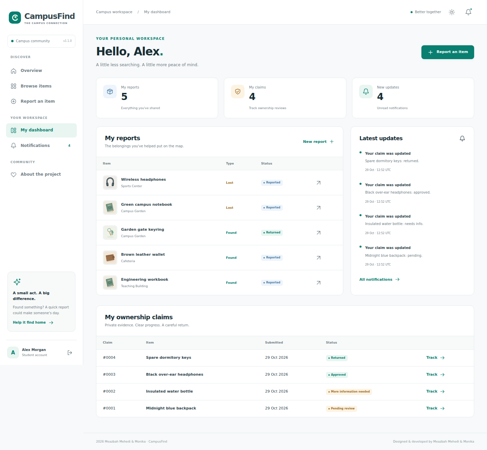 |

| Admin console | Dark theme |
|---|---|
| 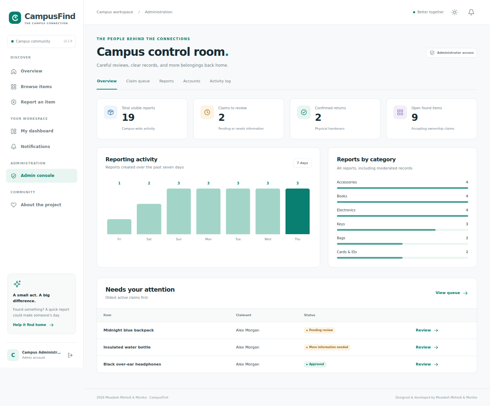 | 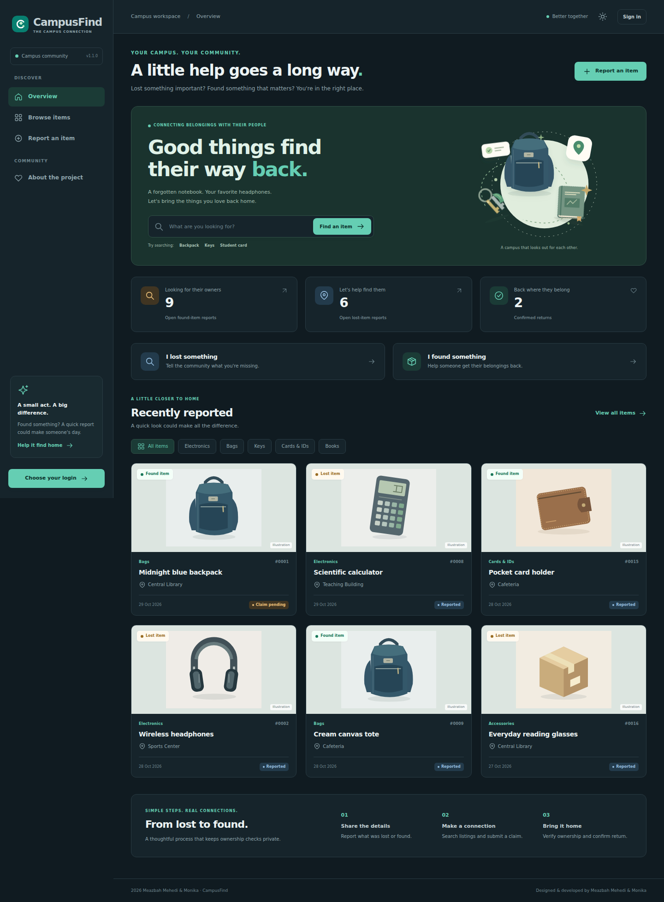 |

| Report an item | Mobile layout |
|---|---|
| 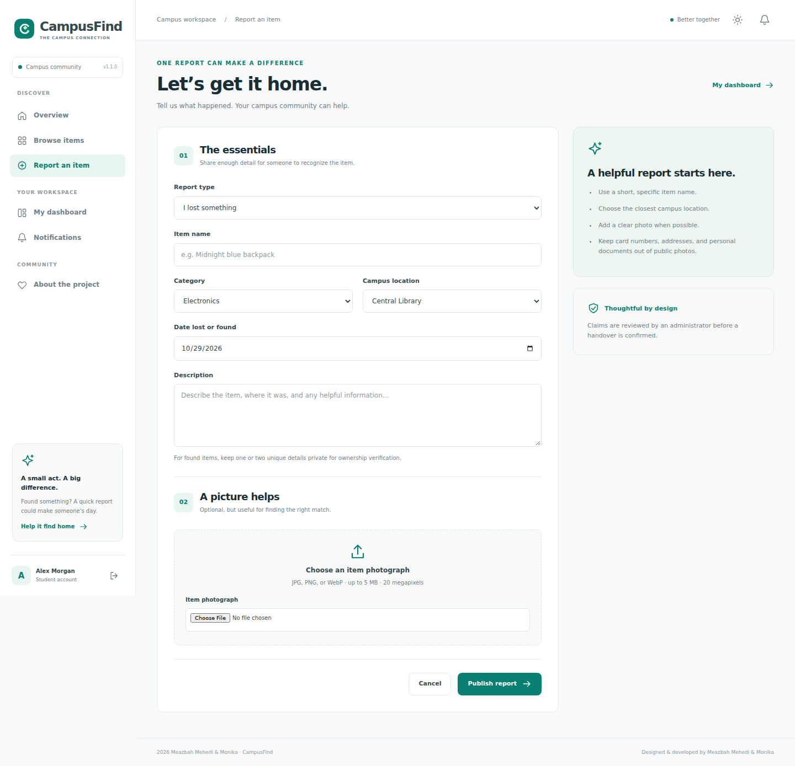 | 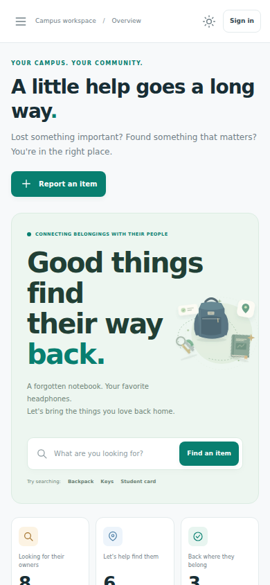 |

## Edit developer and team details

**Edit `config/developer.json`.** This is the single source for developer identity and project branding:

- Project name, title, tagline, copyright and logo.
- Both developers under `team`: name, role, biography, GitHub username/URL, LinkedIn, email, website and avatar path.
- Logo/avatar paths are relative to `campusfind/static/`.

Blank optional links are hidden. Social links open in a new tab. Add image files to `campusfind/static/img/` and set their paths in the JSON file. Keep the default logo if you do not need a replacement.

After editing:

```bash
python scripts/sync_branding.py
```

Restart the application to refresh the UI. The command refreshes this README from `docs/README.template.md`; put future README content edits in that template. Restart and recapture screenshots if branding changes should appear in them. Secrets do not belong in the developer file.

## Architecture

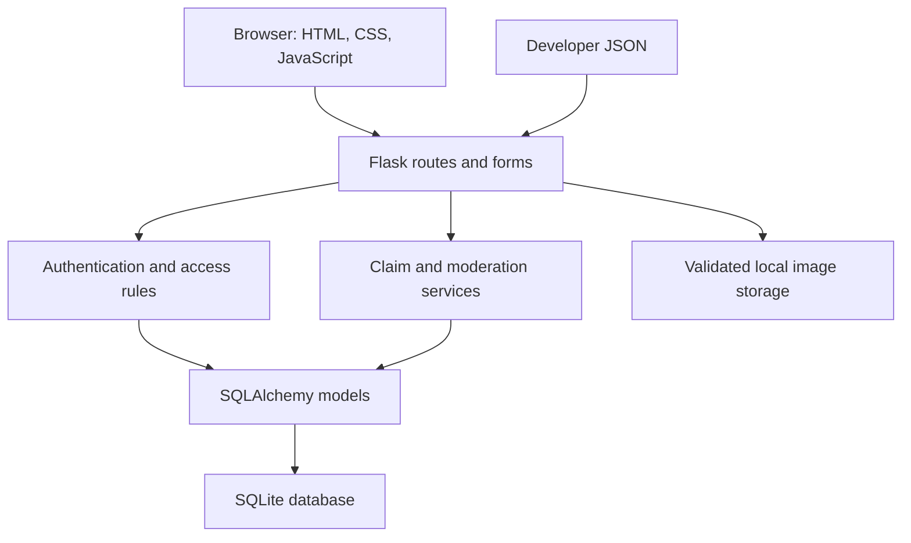

Python handles validation, accounts, searching, claims, transitions, and database operations. Jinja templates render the pages. Small local JavaScript files handle themes, mobile navigation, confirmations, and photo previews. All assets are served locally; there are no CDN or font-service requirements.

The application factory configures extensions. Separate blueprints keep public pages, authentication, reports, claims, and administration organized. `services.py` groups shared transitions. Alembic migrations version the schema.

### Project structure

```text
campusfind/
├── campusfind/
│   ├── __init__.py         # Application factory, security headers, configuration
│   ├── models.py          # Accounts, reports, claims, messages, events, notifications
│   ├── forms.py           # Server-side validation
│   ├── auth.py            # Separate student/admin login and account routes
│   ├── reports.py         # Reporting, search, image access
│   ├── claims.py          # Student claim routes
│   ├── admin.py           # Review, moderation, accounts, charts
│   ├── services.py        # Shared transitions and image processing
│   ├── views.py           # Overview, dashboard, notifications, about
│   ├── cli.py             # Setup, demo data, account recovery, reset
│   ├── templates/
│   └── static/            # Local CSS, JavaScript, SVG artwork
├── config/developer.json  # Editable developer and team details
├── docs/                  # Engineering docs and real screenshots
├── migrations/            # Versioned schema
├── scripts/               # README branding and Docker startup
├── tests/                 # Workflow and permission tests
├── .github/workflows/     # GitHub Actions
├── .env.example
├── requirements.txt       # Compatible dependency ranges
├── requirements-lock.txt  # Exact runtime versions used for this release
├── requirements-dev.txt
├── setup_project.py
├── start.bat / start.sh
├── Dockerfile / compose.yaml
└── run.py
```

Runtime data lives in `instance/`: SQLite database, processed images, and the generated local session key. These records and secrets are excluded from Git and the release ZIP. The ZIP includes only `instance/admin-bootstrap.json`, a one-time hashed administrator setup. It is consumed on setup and is also ignored by Git.

## Configuration and operations

| Variable | Default | Purpose |
|---|---|---|
| `SECRET_KEY` | Persistent random key in `instance/secret.key` | Signs sessions and CSRF tokens |
| `DATABASE_URL` | Local SQLite database | SQLAlchemy connection URI |
| `HOST` | `127.0.0.1` | Bind address |
| `PORT` | `5000` | Server port |
| `COOKIE_SECURE` | `false` | Set `true` for HTTPS hosting |

- `python -m flask --app campusfind:create_app init-db` applies schema migrations and is safe to repeat.
- `python -m flask --app campusfind:create_app reset-password` recovers an account through the trusted local operator.
- `python -m flask --app campusfind:create_app reset-data` asks for confirmation before deleting all application data. Keep backups first.
- Stop the server before copying the complete `instance/` directory for a consistent SQLite-and-images backup. Restore it with the server stopped. Keep that backup private.

### Docker (optional)

```bash
docker compose up --build -d
docker compose exec campusfind python -m flask --app campusfind:create_app create-admin
```

Open http://127.0.0.1:5000. For a fresh demonstration database instead of real accounts:

```bash
docker compose exec campusfind python -m flask --app campusfind:create_app seed-demo
```

When creating the administrator interactively in Docker, enter `admin@gmail.com` and your chosen password. The one-time ZIP setup is for local installations and is not copied into the Docker image.

The named volume retains the database, uploads, and session key. `docker compose down` preserves it; `docker compose down -v` deletes it. The image runs as a non-root user. Docker startup files are provided; see `docs/VALIDATION.md` for which environments were actually checked.

## Testing

```bash
python -m pip install -r requirements-dev.txt
python -m pytest -q
```

Tests use temporary databases. They cover CSRF, role boundaries, private evidence, duplicate/self claims, clarification, approval, competing claims, handover, withdrawals, hidden-image access, upload validation, filtering, notifications, account disabling, migrations, and explicit data reset. GitHub Actions runs the Python suite on Python 3.11 and 3.12 when you push.

## Security and scope

Password hashing, CSRF protection, role checks, session cookie policies, automatic HTML escaping, parameterized database operations, login-attempt limits, and image decoding/re-encoding are built in. Uploads are limited to 5 MB and 20 megapixels; EXIF metadata is stripped. Hidden-report images are not publicly accessible.

The default is a local/small-team application. Email verification, emailed password resets, university SSO, AI recognition, payments, social publishing, and native mobile apps are outside version 1.1.0. In-app notifications update on page requests; they are not email or push notifications. This release does not claim load-tested multi-instance hosting. Review `docs/OPERATIONS.md` before public deployment.

## Documentation

- [Requirements and proposal traceability](docs/REQUIREMENTS.md)
- [System design, data model, use cases and workflows](docs/DESIGN.md)
- [WBS, suggested schedule and risk register](docs/PROJECT_PLAN.md)
- [Student and administrator guide](docs/USER_GUIDE.md)
- [Configuration and operations](docs/OPERATIONS.md)
- [Manual acceptance checklist and release verification](docs/VALIDATION.md)
- [Release notes](CHANGELOG.md)

## Development and design

Designed and developed by the two people below. Names, roles, photographs and social links are editable in `config/developer.json`.

| Name | Role |
|---|---|
| Meazbah Mehedi | Developer & Designer |
| Monika | Developer & Designer |


---

2026 Meazbah Mehedi & Monika
