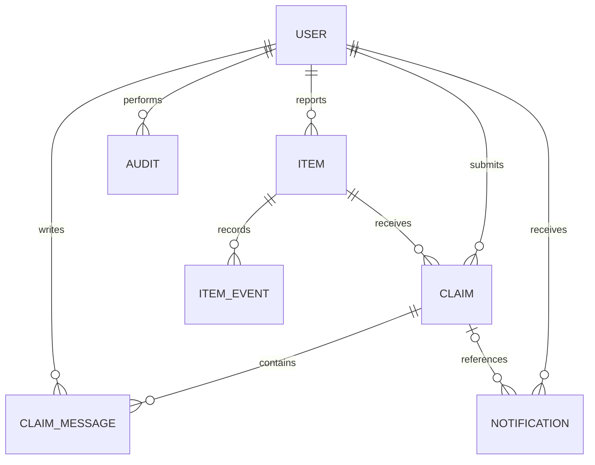
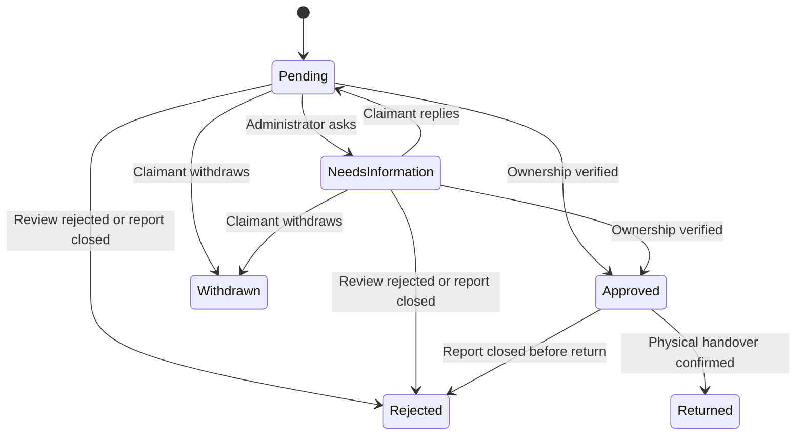

# System design

## Architecture and responsibilities

The app follows a layered Flask structure. HTTP blueprints translate requests into validated forms and database operations. Authentication checks the signed session and loads an enabled account. Shared service functions handle claims, moderation transitions, notifications, event history, and image processing. SQLAlchemy persists domain records. Jinja templates render server-side HTML; JavaScript enhances interaction without replacing the server rules.

| Module | Responsibility |
|---|---|
| `__init__.py` | Factory, configuration, extensions, branding, errors and response policy |
| `models.py` | Schema and password hashing helpers |
| `forms.py` | Type, length, choice, date and upload-extension validation |
| `auth.py` | Registration, sign-in throttling, profile and password changes |
| `reports.py` | Report creation/editing, filters, details, visibility-protected images |
| `claims.py` | Student submission, clarification response, withdrawal |
| `admin.py` | Reviews, moderation, account access and charts |
| `services.py` | Shared business transitions and image re-encoding |
| `views.py` | Home, dashboard, about and notifications |
| `cli.py` | Migrations, admin creation, demo seed, recovery and explicit reset |

## Data model



- **User:** display name, normalized unique email, password hash, role, access flag, timestamps.
- **Item:** author, lost/found type, title, description, category, location, event date, photo reference, status, visibility, reserved claim identifier, timestamps.
- **Claim:** item, claimant, private evidence, status, latest review note, reviewer, timestamps. A unique `(item_id, claimant_id)` constraint prevents duplicate claims.
- **ClaimMessage:** private chronological clarification/review text with author/time.
- **ItemEvent:** public generic report-history labels; no private evidence or claimant identity.
- **Notification:** user-specific body, optional claim link, read flag and creation time.
- **Audit:** administrator identity, action and timestamp.
- **LoginAttempt:** hashed email identity and failure time for a rolling account limit. Old entries are pruned on login submissions.

`reserved_claim_id` is maintained by business transitions rather than a circular foreign key; its matching item/claim relationship is checked before return. Reports and claims are preserved rather than hard-deleted by moderation. Default SQLite is intended for one local instance. Migrations track the schema in Alembic's version table.

## Item states

| Current | Trigger | Next |
|---|---|---|
| Reported | Valid claim | Claim pending |
| Claim pending | All pending claims rejected/withdrawn | Reported |
| Reported / Claim pending | Claim approved | Awaiting handover |
| Awaiting handover | Approved claim physically handed over | Returned |
| Unreturned | Administrator close/hide | Closed |
| Reported, no active claim | Author closes report | Closed |
| Closed and visible | Administrator reopens | Reported |

Visibility is a separate boolean. Hiding a returned report leaves the returned status unchanged. An author closing a lost report does not inflate confirmed-return statistics.

## Claim states



Every administrative review requires a note. Rejected/withdrawn/returned claims cannot be reviewed again through the interface. Competing claims awaiting a decision are rejected when a claim is approved. Database transactions group associated status updates, notifications, messages and activity entries.

## Use cases

| Use case | Actor | Main flow | Alternatives |
|---|---|---|---|
| Report lost item | Student | Sign in → fill details → validate → publish | Invalid date/image gives field feedback |
| Report found item | Student | Sign in → retain private identifying detail → publish | No photograph uses a labeled illustration |
| Search reports | Visitor/student | Enter query → combine filters → inspect details | No matches displays reset guidance |
| Claim found item | Student | Open found report → submit private evidence → track | Own, duplicate or inactive report is rejected |
| Clarify evidence | Claimant/admin | Admin requests detail → claimant replies → pending review | Only requested clarifications accept replies |
| Verify and return | Admin | Read evidence → approve → arrange handover → confirm | Incorrect claim rejected with reason |
| Moderate report | Admin | Inspect report → action + reason → record | Cannot reopen hidden/returned report |
| Manage student access | Admin | View accounts → disable/enable → audit | Admin accounts protected from this screen |

## Claim review sequence

```mermaid
sequenceDiagram
    participant Student
    participant Flask
    participant Database
    participant Admin
    Student->>Flask: Submit claim and CSRF token
    Flask->>Database: Validate item and save evidence
    Database-->>Flask: Claim ID
    Flask-->>Student: Private tracking page
    Admin->>Flask: Approve with note
    Flask->>Database: Reserve item and record decision atomically
    Flask-->>Student: Approved; awaiting handover
    Admin->>Flask: Confirm physical handover
    Flask->>Database: Mark claim and item returned
    Flask-->>Student: Return confirmation
```

## Security boundaries

The server treats all submitted fields as untrusted. Forms enforce lengths and valid choices. SQLAlchemy binds values, templates escape strings, and return URLs are restricted to local paths. All mutating routes require POST and CSRF tokens. Route checks restrict item editing, private claims, account management and moderation. Image bytes are decoded before they are accepted; storage filenames are generated, never user-controlled.

Role assignment is trusted only at local CLI account creation. Account disablement is checked while loading sessions. Administrative activity logging is useful for local review but is not an external tamper-proof audit service. The local operator has database/filesystem access and therefore remains a trusted actor.
