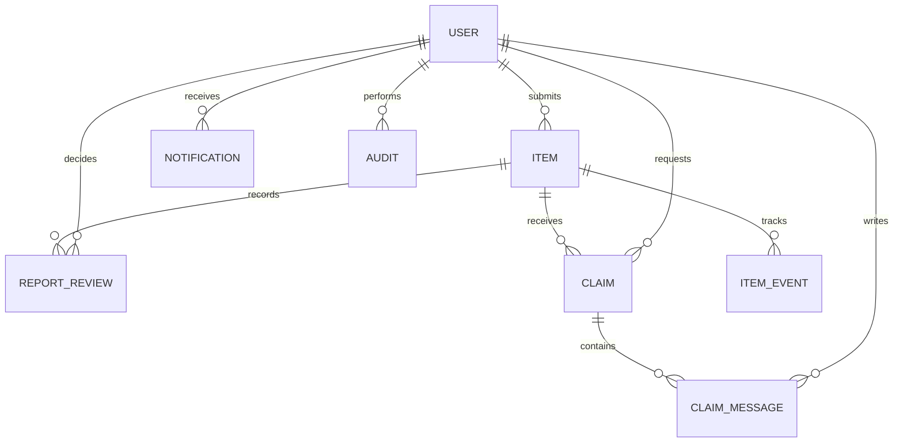
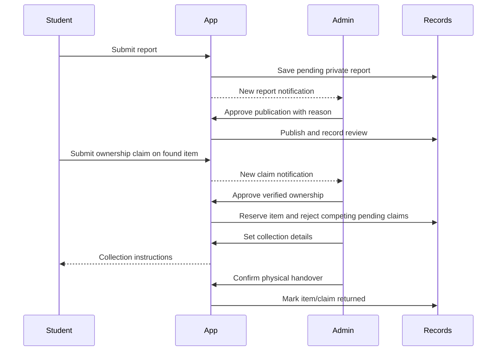

# System design — 1.2.0

## Layers and modules

Flask blueprints accept HTTP requests and validated forms. Role decorators separate student mutations from administrator controls. SQLAlchemy persists records, while Jinja/local CSS/JavaScript render the interface. `moderation.py` owns publication/lifecycle decisions; `services.py` groups ownership transitions, notifications, activity records and image handling. `settings.py` stores campus vocabulary, while `exports.py` produces administrator-only filtered summaries.

The factory registers extensions, branding, policies, role-aware authentication redirects and error handling. `auth.py` handles separate login paths and account maintenance. `views.py` renders public/student pages and redirects administrators away from the student workspace. `reports.py` enforces student submission/editing and approved-public visibility. `claims.py` restricts submission/replies/withdrawals to students while permitting private review by administrators. `admin.py` owns management queues, handovers, account access/history, analytics and settings. `cli.py` performs local setup, migration, recovery, demo seeding and explicitly confirmed data resets.

## Data relationships

- **User:** name, normalized email, password hash, role, enabled flag and creation time.
- **Item:** student author, lost/found details, image, publication review status/note/reviewer/time, lifecycle, hidden flag and reserved claim ID.
- **ReportReview:** private chronological administrator decisions, action, note and timestamp.
- **Claim:** private ownership evidence, claimant, status, review note/reviewer, collection point, handover instructions and physical-return timestamp.
- **ClaimMessage:** private clarification/review conversation.
- **ItemEvent:** generic report lifecycle history without ownership evidence.
- **Notification:** recipient, body, read state, optional item/claim link and timestamp.
- **Audit:** administrator, action, record type/ID, previous/next state, reason and UTC timestamp. Legacy entries retain their original action even when structured fields are empty.
- **CampusSetting:** JSON-backed category/location/collection lists and default collection guidance.
- **LoginAttempt:** hashed account identity and failed-sign-in timestamp for the rolling local limit.

A unique `(item_id, claimant_id)` constraint prevents duplicate claims. `reserved_claim_id` is maintained by checked transitions rather than a circular foreign key; ownership and lifecycle must agree before a return. Related updates, notifications, messages and audit entries are committed together.

## Separate publication and lifecycle

| Publication state | Meaning | Public access |
|---|---|---|
| Pending | New or edited report awaits approval | Author/admin only |
| Needs changes | Administrator requested corrections | Author/admin only |
| Approved | Publication accepted | Public if not hidden |
| Rejected | Review rejected; lifecycle closed | Author/admin only |

| Lifecycle | Meaning |
|---|---|
| Reported | Available report, subject to publication approval |
| Claim pending | One or more ownership reviews remain undecided |
| Awaiting handover | One claim is approved and reserves the item |
| Returned | Physical handover confirmed |
| Closed | Activity stopped without changing it into a confirmed return |

The hidden flag independently blocks public access. Closing/hiding an active report rejects its undecided/approved claims and clears reservation. Restoring visibility leaves lifecycle unchanged. Reopening preserves old claim decisions. Rejected reports become pending again; approved reports retain their publication approval. Returned reports cannot be reopened or changed to closed through normal moderation.

## Main workflow

## Upgrading earlier databases

The second Alembic migration adds publication/collection/audit fields, private report review history and campus settings without clearing records. Existing reports are backfilled approved because they were already published. The database default then changes to pending for future inserts, matching the model default. Existing claims and generic audit actions remain intact; no physical-return timestamp is invented for older records. Previously administrator-authored content is retained as history but cannot be manipulated through student routes.

## Security and operational boundaries

All state-changing web forms require CSRF. Registration cannot assign an administrator role. Permission checks run before student/admin actions and are not limited to menu visibility. Item details and image downloads share publication/hidden access rules. Claim proof is private to the claimant and administrators even if the public item later closes/hides. Ordinary finders cannot read another student's evidence.

Images are decoded/re-encoded with generated storage names, size/pixel limits and stripped EXIF. HTML is escaped and SQL values are bound. CSV cells beginning with formula markers are neutralized; PDF text is escaped before formatting. Exports exclude evidence and are admin-only. Default deployment is one SQLite-backed local instance, with local upload storage and a persistent session key. Application activity records are not tamper-proof against the trusted filesystem operator.
