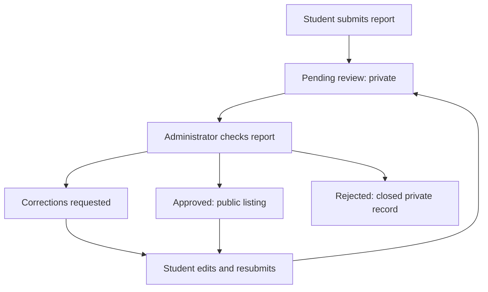
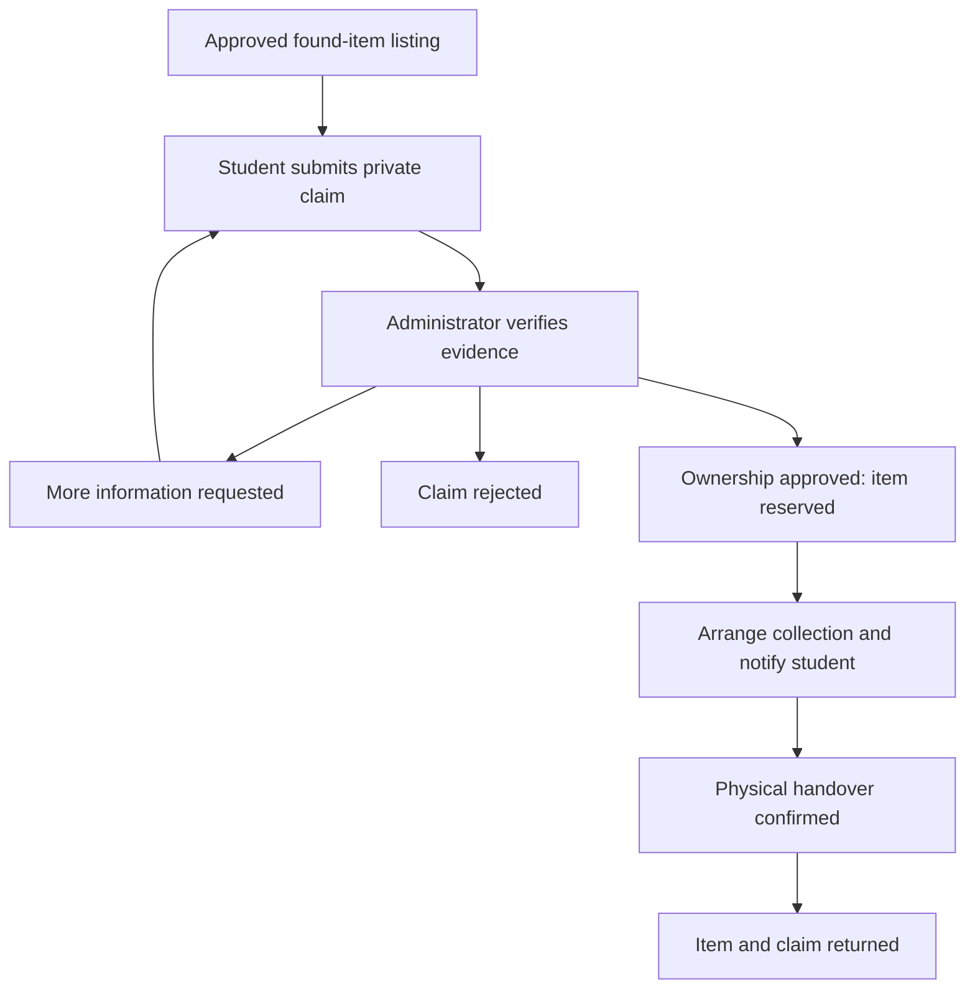
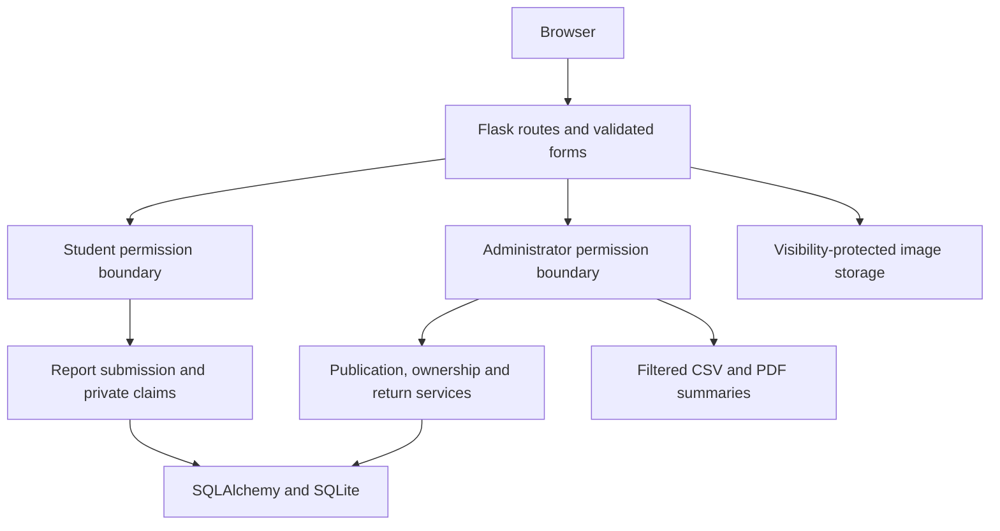

<div align="center">


# {{project_name}} 1.2.0

**{{tagline}}**

{{project_title}} — a Python application for student reports, private ownership claims, administrator review and confirmed item returns.

**Python 3.11+ · Flask · SQLAlchemy · SQLite · Responsive UI**

[Quick start](#quick-start) · [Management workspace](#management-workspace) · [Workflows](#workflows) · [Screenshots](#screenshots) · [Documentation](#documentation)

</div>


## What changed in 1.2.0

Administrators now use a **management-only workspace**. They cannot create lost/found reports, submit claims, reply as claimants, or use student editing/closure actions. These restrictions are enforced on the server as well as in navigation.

**New and edited student reports require publication approval.** Report approval, ownership approval and physical return are separate steps. The release also adds correction requests, student history/access management, a handover queue, campus settings, filtered CSV/PDF summaries and detailed decision history.

## Quick start

Install Python 3.11 or newer, extract the ZIP, and open a terminal in the folder containing `run.py`.

```powershell
# Windows PowerShell
python setup_project.py
.\start.bat
```

```bash
# Linux / macOS
python3 setup_project.py
chmod +x start.sh
./start.sh
```

Open **http://127.0.0.1:5000**. Select **Login as Student** or **Login as Administrator**. Students can register; administrators cannot register publicly. The administrator opens the management dashboard directly after sign-in.

The supplied ZIP initializes **admin@gmail.com** with the administrator password configured for this delivery. The plaintext password is not in source or documentation. A private one-time hashed setup under the Git-ignored `instance/` directory is consumed after setup. A Git checkout without that private file should create an administrator using the CLI below.

To start with fictional demonstration reports and students instead:

```powershell
python setup_project.py --demo
.\start.bat
```

The demo includes published reports, pending publication requests, a correction request, claims, handovers and completed returns. Setup prints a random password for `student@example.com` and `finder@example.com`. This **does not replace an already configured administrator password**. Seeding accepts only an empty database or a database containing just one administrator and no reports. It refuses to overwrite existing application records.

Packages need internet for installation. The default app subsequently runs locally without a paid API or external asset services.

### Manual setup and PyCharm

```bash
python -m venv .venv
```

```powershell
# PowerShell
.\.venv\Scripts\Activate.ps1
```

```bash
# Linux / macOS
source .venv/bin/activate
```

Then:

```bash
python -m pip install -r requirements-lock.txt
python -m flask --app campusfind:create_app init-db
# Supplied ZIP: apply the one-time local administrator setup
python -m flask --app campusfind:create_app configure-admin
# Git checkout without that file: use create-admin instead
python run.py
```

`create-admin` prompts for name, email and password. In PyCharm, select `.venv` as the project interpreter and run `run.py` after initialization. Waitress is used on Windows and Linux. Stop with Ctrl+C.

### Updating an existing installation

1. Stop the old server and privately back up the complete `instance/` directory.
2. Copy the new source into the existing project, preserving its database and uploads. Copy the supplied `instance/admin-bootstrap.json` if you want to apply the administrator configuration from this delivery.
3. Run `python setup_project.py` **without `--demo`**.
4. Restart with `.\start.bat` in PowerShell or `./start.sh` on Linux/macOS. Sign out of old sessions and sign in again.

Migrations preserve existing reports, claims, uploads and activity records. Previously public reports are retained as approved, because they were already published under the earlier release. Every new report defaults to pending review. Old administrator-authored reports/claims remain historical records; administrators cannot create more or use student actions on them.

The one-time setup updates the configured administrator account without clearing data. After consumption, subsequent runs do not reset a changed password. Never copy an empty replacement database over your existing one.

## Student workspace

- Register/sign in, edit a display name, change password and sign out.
- Submit lost/found reports with category, campus location, date, description and optional photograph.
- Track publication approval or correction requests in a private report page and dashboard.
- Edit eligible reports and resubmit them for review. Editing a published report removes it from public browsing until approved again.
- Browse only approved, visible listings; search/filter by type, category, location, lifecycle and event date.
- Submit private evidence for an active found item; respond to clarification and track decisions.
- Withdraw an undecided claim or close an eligible report without active claims.
- Read notifications, review messages and collection instructions.

Uploaded JPG/PNG/WebP images are decoded, limited to 5 MB and 20 megapixels, resized and re-encoded without EXIF metadata. Pending, rejected, correction-requested and hidden reports/photos are accessible only to their author and administrators. No-photo reports use clearly labeled local illustrations.

## Management workspace

| Section | Management functions |
|---|---|
| Dashboard | Pending reports, claims to review, awaiting handovers, confirmed returns, active listings, student counts, daily submissions and recent decisions |
| Item reports | Search/filter all records; approve publication, request corrections, reject, hide, restore, close or reopen eligible reports with a reason |
| Ownership claims | Inspect private evidence, request clarification, approve or reject with a recorded note |
| Handovers | View awaiting collection/completed returns, assign a collection point and instructions, notify the student, confirm physical return |
| Students | Search name/email/access, inspect report/claim history, suspend or reactivate with a reason |
| Analytics & exports | Filter report records by category, location, type, review/lifecycle, visibility and submission dates; export matching records as CSV/PDF |
| Activity log | Review actor, record, previous/next state, reason and UTC timestamp; filter by record type |
| Campus settings | Edit categories, locations, collection points and default collection instructions; keep historical report labels |

Administrator notifications link to new reports and ownership claims. Account settings remain available without exposing student creation/claim controls.

## Workflows

### Publication review



A rejection is recorded rather than deleting the report. A rejected report must be reopened by an administrator before student editing/resubmission. Review reasons and history are private to the student author and administrators.

### Ownership and return



Students cannot claim their own report or submit a second claim on the same report. One approved claim reserves an item; competing undecided claims are rejected with an explanation. Administrators cannot approve legacy claims involving their own account.

### Close, hide and reopen

- **Close** stops activity with a reason and rejects active claims, preserving all records.
- **Hide** removes a report/photo from public access and closes an unreturned active report.
- **Restore** changes visibility only; it does not reopen a closed report.
- **Reopen** makes an eligible visible closed report active again. Rejected reports go back to pending publication review; previously approved reports retain approval. Prior rejected/withdrawn claims stay decided.
- **Returned** means an actual handover. Returned reports cannot be reopened or changed into closed reports through normal moderation. Hiding them retains the confirmed return.

A lost listing and its corresponding found listing are not automatically linked. The verified found-item claim records the return; a related lost listing can be closed separately without counting a second return.

## Screenshots

All screenshots show the running application with fictional demonstration reports.

| Student login | Administrator login |
|---|---|
|  |  |

| Report review queue | Publication decision |
|---|---|
|  |  |

| Handovers | Analytics |
|---|---|
|  |  |

| Student dashboard | Student history |
|---|---|
|  |  |

| Campus settings | Mobile administration |
|---|---|
|  |  |

Additional overview, dark-theme, item, pending-report, activity, claims, About and mobile-login screenshots are in `docs/screenshots/`.

## Developer details

Edit **`config/developer.json`** to change project branding and the two developer profiles. Each `team` entry supports name, role, biography, GitHub username/URL, LinkedIn, email, website and avatar path. Logo/photo paths are relative to `campusfind/static/`. Blank optional links are hidden; social links open in a new tab.

```bash
python scripts/sync_branding.py
```

Restart the app to refresh its configuration. The script regenerates README.md from `docs/README.template.md`; keep substantive README edits in the template. Screenshots must be recaptured if their displayed branding should change. Campus settings are editable by administrators; developer identity remains file-based.

## Architecture



The application factory configures extensions and policy. Blueprints separate accounts, reports, claims, public/student pages and management. `moderation.py` handles publication/lifecycle decisions; `services.py` handles shared claim transitions, notifications and image processing. `settings.py` persists campus choices. `exports.py` produces filtered administrative summaries. Jinja renders pages and local JavaScript handles themes, navigation, confirmations and previews.

```text
campusfind/
├── campusfind/
│   ├── __init__.py      # Factory, configuration, headers, role-aware sign-in
│   ├── auth.py          # Student/admin login and account settings
│   ├── reports.py       # Student reports, approved browsing, photo visibility
│   ├── claims.py        # Private student claims and tracking
│   ├── admin.py         # Management queues, handovers, access, analytics
│   ├── moderation.py    # Publication and lifecycle decisions
│   ├── services.py      # Permissions, claims, notifications, image validation
│   ├── settings.py      # Editable campus categories, locations and collection
│   ├── exports.py       # Filtered CSV/PDF summaries
│   ├── models.py        # Records, reviews, messages, audit and settings
│   ├── forms.py         # Server validation
│   ├── views.py         # Public/student pages and notifications
│   ├── cli.py           # Setup, maintenance, recovery and demo commands
│   ├── templates/       # Responsive student and management screens
│   └── static/          # Local CSS, JS, artwork and PDF font/license
├── config/developer.json
├── docs/
├── migrations/
├── tests/
├── scripts/
├── .github/workflows/tests.yml
├── requirements*.txt
├── setup_project.py
├── start.bat / start.sh
├── Dockerfile / compose.yaml
└── run.py
```

## Operations

Runtime data lives in the Git-ignored `instance/` directory. The release excludes databases, uploaded student photographs, session keys, caches and virtual environments. Only the one-time hashed administrator setup is supplied under `instance/` in the ZIP; it is never served by web routes.

| Setting | Default | Purpose |
|---|---|---|
| `SECRET_KEY` | Persistent random key in `instance/secret.key` | Signed sessions and CSRF |
| `DATABASE_URL` | Local SQLite database | SQLAlchemy connection URI |
| `HOST` | `127.0.0.1` | Listener address |
| `PORT` | `5000` | Listener port |
| `COOKIE_SECURE` | `false` | Set true for HTTPS hosting |

Copy `.env.example` to `.env` for overrides. Do not put secrets in developer JSON. To back up SQLite and photos consistently, stop the server and privately copy the complete `instance/` directory. Restore with the server stopped.

Useful commands:

```bash
python -m flask --app campusfind:create_app init-db
python -m flask --app campusfind:create_app create-admin
python -m flask --app campusfind:create_app reset-password
# Destructive: asks before deleting all application data
python -m flask --app campusfind:create_app reset-data
```

### Optional Docker

```bash
docker compose up --build -d
docker compose exec campusfind python -m flask --app campusfind:create_app create-admin
```

Enter your administrator email/password interactively. The local ZIP setup is not copied into the image. A named volume persists the database/uploads/key; `docker compose down` preserves it, while `docker compose down -v` removes it. Docker files are supplied but were not runtime-tested for this release.

## Verification

```bash
python -m pip install -r requirements-lock.txt -r requirements-dev.txt
python -m pytest -q
```

The suite tests role boundaries, publication privacy, corrections/resubmission, ownership verification, handover, closure/reopening, student access, campus choices, CSV/PDF filtering, CSRF and migration from an earlier schema. See [release validation](docs/VALIDATION.md) for the exact checked environments and results. GitHub Actions is configured for Python 3.11/3.12.

## Scope

Version 1.2.0 is a local/small-team application. It includes password hashing, CSRF protection, role checks, safe image processing, visibility checks and application activity records. CSV exports neutralize leading spreadsheet-formula characters; summaries omit private claim evidence. The PDF export embeds a local font; CSV preserves UTF-8 data.

Email verification, university SSO, email/push notifications, AI matching, payments, social-media publishing and native mobile apps are outside this release. Notifications update on page requests. Application logs are not an external tamper-proof service. Public deployment, high-load capacity and non-SQLite databases require separate validation.

## Documentation

- [Requirements](docs/REQUIREMENTS.md)
- [Design and data model](docs/DESIGN.md)
- [WBS, suggested schedule and risks](docs/PROJECT_PLAN.md)
- [User guide](docs/USER_GUIDE.md)
- [Operations and configuration](docs/OPERATIONS.md)
- [Validation](docs/VALIDATION.md)
- [Release notes](CHANGELOG.md)

## Development and design

| Name | Role |
|---|---|
{{team_table}}

All profile details are editable in the separate developer configuration.

---

{{copyright}}
